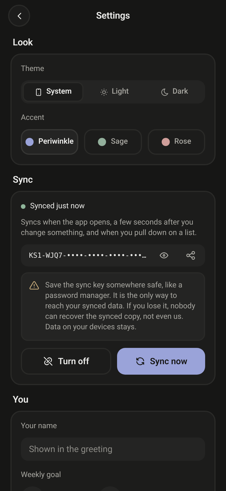
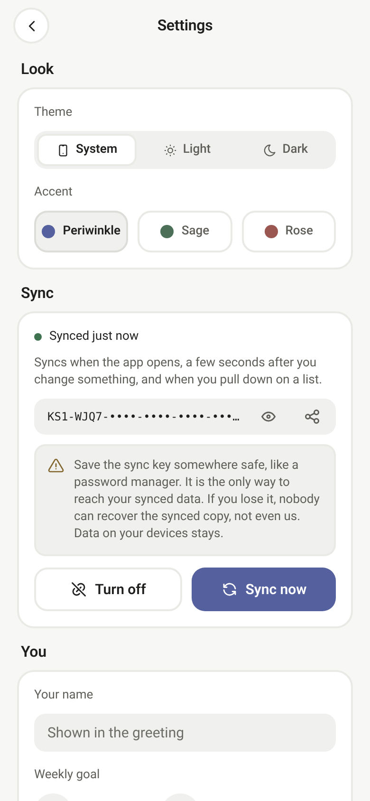

# kryfsec mobile

kryfsec phone app, the companion to the [kryfsec desktop app](https://github.com/0xbasinas/kryfsec-desktop). Built with Expo (SDK 58), Expo Router and TypeScript.
Website: [kryfsec.com](https://kryfsec.com)

Your data is saved on the phone (AsyncStorage). It can sync with the desktop app, end-to-end encrypted (see [Sync](#sync)).

Run the commands below from the repo root.

## Run it

The note editor uses [react-native-enriched-markdown](https://github.com/software-mansion/enriched-markdown),
which has native code. That means **Expo Go can not run this app any more**. You need a
development build (your own copy of the app with the native parts inside) or a normal APK.

### Development build on an Android phone (for example a Redmi)

Needs the Android SDK and JDK 17 on the computer.

```bash
npm install
npx expo run:android            # builds the dev app and installs it on the phone over USB
npm start                       # later: start Metro and open the dev app
```

With the phone on the same Wi-Fi (or Tailscale), the dev app finds Metro from the QR code
or the URL shown by `npm start`. Over USB, run `adb reverse tcp:8081 tcp:8081` first.

On Xiaomi / HyperOS, allow the app to "Display pop-up windows while running in the background"
and turn off battery saver for it if it will not reload.

### Install as a normal app (APK)

Local build, no account needed:

```bash
npx expo prebuild --platform android
cd android && ./gradlew assembleRelease
# APK: android/app/build/outputs/apk/release/app-release.apk
```

Or in the cloud with EAS: `npm i -g eas-cli && eas build -p android --profile preview` (free Expo account).

The `android/` and `ios/` folders are made by `npx expo prebuild` and are not committed.

## Sync

Settings → **Sync** on the phone. Pair with the desktop app:

1. Desktop: Settings → Sync → *Turn on sync*. It shows a QR code.
2. Phone: *Scan the desktop QR code* (or *Paste a key*) and confirm.
   The example data on the phone is removed; your own entries stay.

The phone can also start a sync (*New sync here*) and share the key to type into the desktop app (*I have a key*).

- Data is encrypted on the phone (AES-256-GCM) before it is sent. The server at `sync.kryfsec.com` only stores locked data.
- The key is kept in the Android Keystore / iOS Keychain (`expo-secure-store`).
- **If you lose the key, the synced copy cannot be recovered.** Data on each device stays.
- Syncs when the app opens or comes back to the front, a few seconds after a change, every 5 minutes while open,
  on *Sync now* and when you pull down on a list. Works offline: changes are sent later.
- The camera is only used to scan the QR code. The picture is not saved or sent.

How changes from two devices are merged: [docs/merging.md](https://github.com/0xbasinas/kryfsec-sync/blob/main/docs/merging.md).
Server and shared sync code: [kryfsec-sync](https://github.com/0xbasinas/kryfsec-sync). The shared code is copied into `src/sync-core/` (do not edit it there).

 

The sync shots are from the web preview. On the web preview the confirm dialogs do not show, so joining and turning off only work in the phone app.

## Scripts

- `npm run typecheck` – TypeScript check
- `npm run lint` – Expo lint
- `npm run android` – build and run the dev app (`expo run:android`)
- `npm start` – Metro for the dev app

## Layout

- `src/app` – screens (Expo Router). Tabs: Home, Journal, Roadmap, Labs, More.
- `src/components` – UI pieces, charts, tab bar, note editor (`note-editor.tsx`) and note viewer (`note-view.tsx`).
- `src/lib` – types, sample data and stats (shared with the desktop app), store, note blocks (`note-blocks.ts`), sync (`sync.ts`).
- `src/sync-core` – shared sync code copied from kryfsec-sync.
- `src/theme` – colors for dark and light, same as the desktop app.
- `screenshots/` – shots from the Android emulator (sync shots from the web preview).

## Notes editor

- Text, headings, bold, italic, strike, links and lists are edited in the native rich input from enriched-markdown.
- That input does not support code blocks, checklists or quotes, so those are their own blocks
  (type ```` ``` ````, `[]` or `>` on an empty line, or use the toolbar).
- Inline code stays as `` `text` `` with its backticks while you edit, and shows as code when you read.
- Tables are kept as plain markdown text while editing.
- Notes are saved as markdown, so they open the same way in the desktop app.

## Licenses

MIT – see [LICENSE](LICENSE). Third-party packages: [THIRD_PARTY_NOTICES.md](THIRD_PARTY_NOTICES.md).
